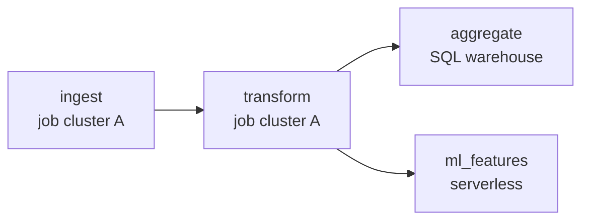
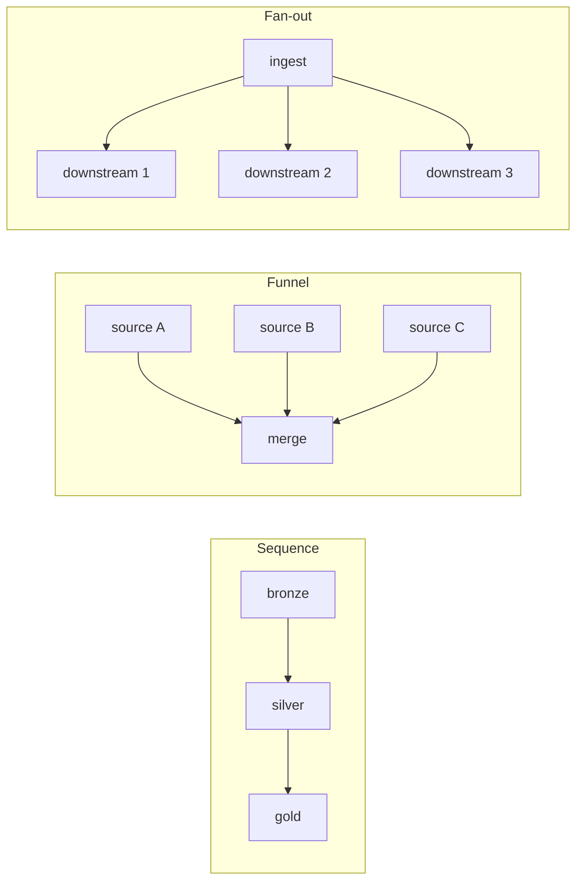
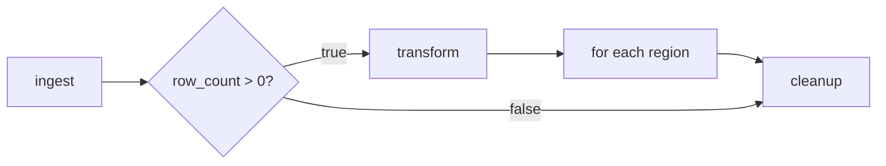

Bài viết này tổng hợp những kiến thức nền tảng khi làm việc với Databricks, đi theo thứ tự: cách tổ chức data với **Unity Catalog**, cách xây dựng một **Job** (workflow), cách **orchestrate** các task, cách chọn **compute**, và cuối cùng là các **best practices** khi đưa pipeline lên production.

Các ví dụ trong bài ưu tiên hai hướng triển khai:
- **Declarative Automation Bundles** (trước đây là Databricks Asset Bundles - DABs): khai báo resource bằng YAML, deploy bằng `databricks bundle deploy`.
- **Databricks SDK for Python** (`databricks-sdk`): tạo và điều khiển resource bằng code.

# Unity Catalog và data namespace

## Catalog → Schema → Table/Volume

**Catalog → Schema → Tables/Volumes** là đường dẫn bạn sẽ dùng mỗi khi làm việc với data trong Databricks. Đây là namespace ba cấp (`catalog.schema.object`) giúp Unity Catalog mạnh về governance và security.

- **Catalog** là container lớn nhất. Thường mỗi môi trường (dev, staging, prod) hoặc mỗi business unit sẽ có catalog riêng.
- **Schema** (hay còn gọi là database) nhóm các object liên quan với nhau theo project, team hoặc data domain. Schema không chỉ chứa table mà còn chứa cả volume, model và function.
- **Table** lưu data có cấu trúc, truy vấn được bằng SQL, sử dụng open table format (Delta Lake).
- **Volume** lưu file thô (CSV, JSON, Parquet, ảnh, ...) trước khi chúng trở thành table. Có thể xem volume là một managed folder để landing file cần xử lý.

## Unity Catalog là gì

**Unity Catalog** là lớp governance tập trung của Databricks cho toàn bộ data và AI asset. Nó quản lý:
- **Metadata và namespace**: toàn bộ hệ thống phân cấp phía trên.
- **Access control**: phân quyền (`GRANT`/`REVOKE`) theo user, group hoặc service principal, áp dụng thống nhất cho mọi workspace dùng chung metastore.
- **Lineage và audit**: tự động theo dõi ai tạo table, tạo khi nào, ai đang truy cập và data đi từ đâu đến đâu.

Khi bạn tạo một table trong một schema, Unity Catalog tự động ghi nhận owner, thời điểm tạo và quyền truy cập.

## Một vài câu lệnh cơ bản

Khám phá cấu trúc:

```sql
SHOW CATALOGS;
SHOW SCHEMAS IN dev;
SHOW TABLES IN dev.sales;
SHOW VOLUMES IN dev.sales;

-- Liệt kê file trong volume
LIST '/Volumes/dev/sales/raw_files/';
```

Đọc file thô từ volume và tạo table bằng **CTAS** (`CREATE TABLE AS SELECT`):

```sql
CREATE OR REPLACE TABLE dev.sales.orders_bronze AS
SELECT *
FROM read_files(
  '/Volumes/dev/sales/raw_files/orders/',
  format => 'csv',
  header => true
);
```

Khi đọc file bằng `read_files` (hoặc Auto Loader), những dòng/cột không khớp với schema sẽ không bị mất mà được đưa vào cột **`_rescued_data`** dưới dạng JSON. Đây là cách để phát hiện schema drift hay dữ liệu bẩn mà không làm fail pipeline:

```sql
-- Tìm các record có dữ liệu không parse được
SELECT * FROM dev.sales.orders_bronze
WHERE _rescued_data IS NOT NULL;
```

## Khai báo schema và volume bằng bundle

Thay vì tạo tay bằng UI, ta khai báo schema và volume trong `databricks.yml`:

```yaml
bundle:
  name: sales_pipeline

targets:
  dev:
    mode: development
    default: true
    workspace:
      host: https://<workspace-dev>.cloud.databricks.com
  prod:
    mode: production
    workspace:
      host: https://<workspace-prod>.cloud.databricks.com

resources:
  schemas:
    sales:
      catalog_name: ${bundle.target}
      name: sales
      comment: "Data domain sales"
      grants:
        - principal: data-analysts
          privileges: [USE_SCHEMA, SELECT]

  volumes:
    raw_files:
      catalog_name: ${bundle.target}
      schema_name: ${resources.schemas.sales.name}
      name: raw_files
      comment: "Landing zone cho file thô"
```

Cách làm này giúp tên catalog tự đổi theo target (`dev`, `prod`) và quyền truy cập được version control cùng với code.

## Làm việc với Unity Catalog bằng SDK

```python
from databricks.sdk import WorkspaceClient
from databricks.sdk.service.catalog import VolumeType

w = WorkspaceClient()

# Liệt kê catalog và schema
for c in w.catalogs.list():
    print(c.name)

for s in w.schemas.list(catalog_name="dev"):
    print(s.full_name)

# Tạo schema và managed volume
w.schemas.create(name="sales", catalog_name="dev", comment="Data domain sales")
w.volumes.create(
    catalog_name="dev",
    schema_name="sales",
    name="raw_files",
    volume_type=VolumeType.MANAGED,
)

# Upload file vào volume
with open("orders.csv", "rb") as f:
    w.files.upload("/Volumes/dev/sales/raw_files/orders/orders.csv", f, overwrite=True)
```

# Cấu trúc của một Job

## Job và Task

- **Job** là đơn vị orchestration cao nhất: một workflow có thể schedule, trigger, giám sát và cấu hình compute, notification, parameter.
- **Task** là một đơn vị công việc bên trong job. Một job gồm một hoặc nhiều task, các task liên kết với nhau thành một **DAG** (Directed Acyclic Graph) thông qua quan hệ `depends_on`.

Nói cách khác: job quyết định *khi nào* và *với cấu hình chung nào* workflow chạy, còn task quyết định *làm gì*.

## Các loại task được hỗ trợ

Một task có thể là:
- Databricks **notebook**
- **Lakeflow Spark Declarative Pipelines** (trước đây là DLT)
- **SQL** (file, query, alert, dashboard)
- **Python script**, **Python wheel**
- **JAR** (Java/Scala), **Spark submit**
- **dbt**
- **Dashboard** refresh (và Power BI)
- Control-flow task: **run job**, **if/else condition**, **for each**

Hai loại phổ biến nhất khi mới bắt đầu là **notebook task** và **SQL task**:

| | Notebook task | SQL task |
|---|---|---|
| Nguồn code | Workspace hoặc Git | SQL file, saved query, alert, dashboard |
| Compute | Job cluster, serverless, all-purpose | **SQL warehouse** |
| Option chính | `notebook_path`, `source`, `base_parameters` | `warehouse_id`, `file`/`query`, `parameters` |

## Các ngôn ngữ được hỗ trợ

Databricks hỗ trợ **Python, SQL, Scala và R** trong notebook, Java qua JAR task. Trong thực tế data engineer dùng Python và SQL nhiều nhất.

## Ví dụ: job có notebook task và SQL task (bundle)

```yaml
resources:
  jobs:
    daily_sales:
      name: "[${bundle.target}] daily_sales"

      parameters:
        - name: catalog
          default: ${bundle.target}

      tasks:
        - task_key: ingest
          notebook_task:
            notebook_path: ../src/ingest.py
            base_parameters:
              source_path: /Volumes/${bundle.target}/sales/raw_files/orders/

        - task_key: aggregate
          depends_on:
            - task_key: ingest
          sql_task:
            warehouse_id: ${var.warehouse_id}
            file:
              path: ../src/aggregate_daily.sql
            parameters:
              catalog: "{{job.parameters.catalog}}"
```

Deploy và chạy:

```bash
databricks bundle validate
databricks bundle deploy -t dev
databricks bundle run daily_sales -t dev
```

## Ví dụ: tạo job tương tự bằng SDK

```python
from databricks.sdk import WorkspaceClient
from databricks.sdk.service import jobs

w = WorkspaceClient()

created = w.jobs.create(
    name="daily_sales",
    parameters=[jobs.JobParameterDefinition(name="catalog", default="dev")],
    tasks=[
        jobs.Task(
            task_key="ingest",
            notebook_task=jobs.NotebookTask(
                notebook_path="/Workspace/Users/me/ingest",
                base_parameters={"source_path": "/Volumes/dev/sales/raw_files/orders/"},
            ),
        ),
        jobs.Task(
            task_key="aggregate",
            depends_on=[jobs.TaskDependency(task_key="ingest")],
            sql_task=jobs.SqlTask(
                warehouse_id="<warehouse-id>",
                file=jobs.SqlTaskFile(path="/Workspace/Users/me/aggregate_daily.sql"),
            ),
        ),
    ],
)

run = w.jobs.run_now(job_id=created.job_id).result()  # chờ run kết thúc
print(run.state.result_state)
```

# Compute cho Job

Có 4 loại compute chính:

- **Interactive cluster (all-purpose cluster)**: dùng cho development, ad-hoc, exploration và được nhiều user chia sẻ. Chi phí không hiệu quả vì cluster chạy liên tục, tài nguyên có thể bị tranh chấp, **không nên dùng cho production**.
- **Job cluster**: cluster được tạo riêng cho job và tự terminate khi job kết thúc. Cấu hình production-grade, giá DBU rẻ hơn khoảng 50% so với all-purpose. Đổi lại phải chờ cluster khởi động. Nhiều task trong cùng job có thể dùng chung một job cluster để tiết kiệm thời gian và chi phí.
- **Serverless compute**: Databricks quản lý hoàn toàn, khởi động nhanh, auto scaling, Photon bật mặc định. Tổng chi phí thường thấp hơn nhờ không phải trả cho thời gian idle và công sức vận hành, phù hợp với phần lớn use case.
- **SQL warehouse**: compute dành cho SQL query, dashboard và BI. Mặc định là serverless, hỗ trợ concurrency cao, auto scaling, auto start/stop và cho phép chỉnh cluster sizing.

Với serverless job còn có hai performance mode:
- **Standard**: ưu tiên cost, thời gian khởi động lâu hơn, phù hợp workflow không gấp.
- **Performance optimized**: khởi động và thực thi nhanh hơn, dùng khi cần SLA chặt.

## Chọn compute cho từng task

Mỗi task có thể gán compute riêng; các task trong cùng job có thể dùng chung compute hoặc dùng compute khác nhau.



Ví dụ bundle với job cluster dùng chung và task serverless:

```yaml
resources:
  jobs:
    mixed_compute:
      name: mixed_compute

      # Standard/optimized chỉ áp dụng cho serverless job
      performance_target: STANDARD

      job_clusters:
        - job_cluster_key: shared_etl
          new_cluster:
            spark_version: 16.4.x-scala2.13
            node_type_id: i3.xlarge
            runtime_engine: PHOTON
            autoscale:
              min_workers: 2
              max_workers: 8

      tasks:
        - task_key: ingest
          job_cluster_key: shared_etl
          notebook_task:
            notebook_path: ../src/ingest.py

        - task_key: transform
          depends_on: [{ task_key: ingest }]
          job_cluster_key: shared_etl          # dùng lại cluster, không phải start lại
          notebook_task:
            notebook_path: ../src/transform.py

        - task_key: aggregate
          depends_on: [{ task_key: transform }]
          sql_task:                             # chạy trên SQL warehouse
            warehouse_id: ${var.warehouse_id}
            file:
              path: ../src/aggregate.sql
```

> Lưu ý: tuỳ cấu hình workspace, task không chỉ định cluster sẽ chạy serverless. Tên `spark_version` và `node_type_id` ở trên chỉ là ví dụ, cần đổi theo cloud và runtime bạn đang dùng.

# Task orchestration

**DAG** là khái niệm chung để biểu diễn một chuỗi hoạt động xử lý data gồm nhiều task: mỗi node là một task, mỗi cạnh là một dependency. Databricks dùng DAG để quyết định task nào chạy tuần tự, task nào chạy song song.

Có thể orchestrate bằng nhiều cách: UI, REST API, SQL, bundles và SDK. Dưới đây là cùng một workflow nhỏ ở mỗi cách.

**1. Declarative Automation Bundles** (khuyến nghị cho production): xem các ví dụ YAML phía trên, kết hợp CI/CD.

**2. Databricks SDK:**

```python
w.jobs.run_now(job_id=123, job_parameters={"catalog": "prod"})
```

**3. CLI/REST API:**

```bash
databricks jobs run-now 123 --json '{"job_parameters": {"catalog": "prod"}}'
```

**4. SQL:** khi cần chạy một pipeline được khai báo sẵn bằng SQL, ví dụ refresh materialized view hoặc streaming table, hoặc dùng SQL task như một bước trong job như ví dụ trên.

**5. UI:** phù hợp để thử nhanh, kéo thả task, xem DAG và debug.

## Các pattern workflow phổ biến

- **Sequence pattern**: các task nối tiếp nhau, dùng cho transformation, cleaning, xây dựng **medallion architecture** (bronze → silver → gold).
- **Funnel pattern**: gom nhiều source/connector vào một workflow rồi hợp nhất ở task phía sau.
- **Fan-out pattern** (star pattern): một data source ingest một lần, sau đó phân phối cho nhiều downstream system/xử lý song song.



Ví dụ funnel pattern trong bundle: ba task ingest chạy song song (không có `depends_on`), task `merge` chờ cả ba:

```yaml
tasks:
  - task_key: ingest_a
    notebook_task: { notebook_path: ../src/ingest_a.py }
  - task_key: ingest_b
    notebook_task: { notebook_path: ../src/ingest_b.py }
  - task_key: ingest_c
    notebook_task: { notebook_path: ../src/ingest_c.py }
  - task_key: merge
    depends_on:
      - task_key: ingest_a
      - task_key: ingest_b
      - task_key: ingest_c
    notebook_task: { notebook_path: ../src/merge.py }
```

# Tạo và schedule Job

## Các option cấu hình chung của task

- **Parameters và dynamic value references**: nền tảng để workflow linh hoạt, có thể đặt ở cấp task hoặc job, giúp task tái sử dụng và thay đổi hành vi theo input hoặc runtime context.
- **Notification alerts**: giúp team nắm được tình trạng job và phản ứng nhanh khi có sự cố.
- **Retries**: tuyến phòng thủ đầu tiên với lỗi tạm thời (transient failure), cấu hình được ở cả job và task.

### Parameters

**Task parameters** (key-value) hỗ trợ các kịch bản nâng cao:
- **Conditional execution**: điều khiển nhánh nào của workflow được chạy dựa trên điều kiện data, môi trường hay business rule.
- **Looping**: điều khiển số lần lặp, định nghĩa mảng cho `for each`.
- **Truyền context giữa các task**: task upstream set giá trị để task downstream đọc, tạo data flow song song với control flow.

**Job parameters** áp dụng tự động cho mọi task trong job, ghi đè task parameter cùng tên và có thể override lúc trigger run.

Các dynamic value reference thường dùng: `{{job.parameters.<name>}}`, `{{job.id}}`, `{{job.run_id}}`, `{{tasks.<task_key>.values.<key>}}`.

Truy cập parameter trong task: với notebook dùng `dbutils.widgets.get`, cách đọc khác nhau tuỳ loại task (notebook, SQL, Python wheel, ...).

```python
# notebook task
catalog = dbutils.widgets.get("catalog")
```

### Task values: truyền kết quả giữa các task

Task values được tạo trong lúc chạy nên rất phù hợp với quyết định phụ thuộc kết quả xử lý: số record để kiểm tra data quality, đường dẫn file sinh động, thống kê để monitor, hoặc tiêu chí cho conditional logic.

```python
# Task "ingest": set giá trị
dbutils.jobs.taskValues.set(key="row_count", value=df.count())
```

```python
# Task khác: đọc giá trị
row_count = dbutils.jobs.taskValues.get(
    taskKey="ingest",
    key="row_count",
    default=0,
    debugValue=0,   # dùng khi chạy notebook ngoài job
)
```

Hoặc tham chiếu trực tiếp trong cấu hình bundle:

```yaml
- task_key: report
  depends_on: [{ task_key: ingest }]
  notebook_task:
    notebook_path: ../src/report.py
    base_parameters:
      rows: "{{tasks.ingest.values.row_count}}"
```

### Retries và timeout

```yaml
- task_key: ingest
  max_retries: 3
  min_retry_interval_millis: 60000    # chờ 1 phút giữa các lần retry
  retry_on_timeout: true
  timeout_seconds: 3600
  notebook_task:
    notebook_path: ../src/ingest.py
```

### Notification alerts

- **Job level**: gửi thông báo khi job bắt đầu, thành công, thất bại hoặc bị skip.
- **Task level**: có thể tuỳ chỉnh riêng cho từng task trong job.
- Destination hỗ trợ: email, Slack, PagerDuty, Microsoft Teams, **webhook** (để tích hợp với API bên thứ ba).
- Hỗ trợ cảnh báo **job chạy chậm** (late jobs) dựa trên ngưỡng thời gian, hoặc streaming backlog khi consume data chậm.

```yaml
resources:
  jobs:
    daily_sales:
      email_notifications:
        on_failure: [data-team@example.com]
        on_duration_warning_threshold_exceeded: [data-team@example.com]

      webhook_notifications:
        on_failure:
          - id: <notification-destination-id>   # Slack/PagerDuty... đã tạo trong workspace

      health:
        rules:
          - metric: RUN_DURATION_SECONDS
            op: GREATER_THAN
            value: 3600                          # cảnh báo nếu chạy quá 1 giờ
```

## Triggers

**Trigger** là rule tự động khởi động một run dựa trên điều kiện hoặc lịch.

- **Scheduled (time-based)**: theo cron expression.
- **Continuous (always on)**: run mới được bắt đầu ngay khi run trước kết thúc hoặc fail, Databricks tự quản lý retry. Phù hợp với streaming workload.
- **File arrival**: chạy khi phát hiện file mới ở storage location (S3, Azure, GCS, volume).
- **Table update**: chạy khi một hoặc nhiều table thay đổi (insert, update, delete, merge). Giúp thay thế lịch cron bằng orchestration gần realtime: job chạy ngay khi data mới đến.
- **Manual**: chạy từ UI, API, CLI, SDK hoặc bundle (`databricks bundle run`). Phù hợp với ad-hoc, debug, backfill một lần.

Trigger giúp job chạy mà không cần can thiệp thủ công.

Ví dụ bundle:

```yaml
# Scheduled
schedule:
  quartz_cron_expression: "0 0 6 * * ?"   # 6:00 mỗi ngày
  timezone_id: Asia/Ho_Chi_Minh
  pause_status: UNPAUSED
```

```yaml
# File arrival
trigger:
  pause_status: UNPAUSED
  file_arrival:
    url: /Volumes/prod/sales/raw_files/orders/
    min_time_between_triggers_seconds: 300
```

```yaml
# Table update
trigger:
  pause_status: UNPAUSED
  table_update:
    table_names:
      - prod.sales.orders_bronze
    condition: ANY_UPDATED
```

```yaml
# Continuous
continuous:
  pause_status: UNPAUSED
```

> Một job chỉ dùng một trong các kiểu `schedule`, `trigger` hoặc `continuous`.

Tương tự bằng SDK:

```python
from databricks.sdk.service import jobs

w.jobs.update(
    job_id=123,
    new_settings=jobs.JobSettings(
        trigger=jobs.TriggerSettings(
            pause_status=jobs.PauseStatus.UNPAUSED,
            file_arrival=jobs.FileArrivalTriggerConfiguration(
                url="/Volumes/prod/sales/raw_files/orders/",
                min_time_between_triggers_seconds=300,
            ),
        )
    ),
)
```

## Conditional và iterative task

- **Run if**: điều kiện `run_if` trên dependency để task chạy phụ thuộc kết quả của upstream (`ALL_SUCCESS` mặc định, `AT_LEAST_ONE_SUCCESS`, `NONE_FAILED`, `ALL_DONE`, `AT_LEAST_ONE_FAILED`, `ALL_FAILED`).
- **If/else task**: thêm logic boolean để rẽ nhánh workflow.
- **For each task**: lặp qua một mảng input, chạy task lồng bên trong cho từng phần tử.

```yaml
tasks:
  - task_key: ingest
    notebook_task:
      notebook_path: ../src/ingest.py     # set task value row_count

  # If/else: chỉ xử lý tiếp khi có data
  - task_key: has_data
    depends_on: [{ task_key: ingest }]
    condition_task:
      op: GREATER_THAN
      left: "{{tasks.ingest.values.row_count}}"
      right: "0"

  - task_key: transform
    depends_on:
      - task_key: has_data
        outcome: "true"
    notebook_task:
      notebook_path: ../src/transform.py

  # For each: xử lý song song nhiều region
  - task_key: export_by_region
    depends_on: [{ task_key: transform }]
    for_each_task:
      inputs: '["apac", "emea", "amer"]'
      concurrency: 3
      task:
        task_key: export_region
        notebook_task:
          notebook_path: ../src/export.py
          base_parameters:
            region: "{{input}}"

  # Run if: luôn chạy để gửi thông báo, kể cả khi task phía trước fail
  - task_key: cleanup
    depends_on: [{ task_key: export_by_region }]
    run_if: ALL_DONE
    notebook_task:
      notebook_path: ../src/cleanup.py
```



# Xử lý lỗi và monitoring

Xử lý lỗi không chỉ là chạy lại task, mà là xây dựng hệ thống có khả năng phục hồi hiệu quả và giữ data nhất quán khi một thành phần bị lỗi.

## Repair run

**Repair run** cho phép chạy lại **chỉ những task bị fail** (và các task phụ thuộc chúng), thay vì chạy lại cả job. Ta có thể sửa task hoặc override parameter rồi chạy lại, giúp giảm thời gian và chi phí phục hồi.

Trên UI: click vào task bị fail rồi chọn **Repair run**. Bằng SDK:

```python
run = w.jobs.get_run(run_id=456)

if run.state.result_state == jobs.RunResultState.FAILED:
    w.jobs.repair_run(
        run_id=456,
        rerun_all_failed_tasks=True,
        job_parameters={"catalog": "prod"},   # có thể override parameter khi repair
    ).result()
```

## Monitoring hiệu năng job

- **System tables**: truy vấn lịch sử run, thời gian chạy, chi phí (`system.lakeflow.*`, `system.billing.usage`).
- **Spark UI**: xác định bottleneck qua thời gian task, overlap, planning time và execution time.

```sql
-- Các run thất bại trong 7 ngày gần nhất
SELECT job_id, run_id, result_state, period_start_time
FROM system.lakeflow.job_run_timeline
WHERE result_state IN ('FAILED', 'ERROR', 'TIMED_OUT')
  AND period_start_time >= current_date() - INTERVAL 7 DAYS
ORDER BY period_start_time DESC;
```

# Best practices

Ba nguyên tắc chính: chọn **compute đúng** để tối ưu performance/cost theo yêu cầu vận hành, **thiết kế modular** để dễ maintain và tái sử dụng, và dùng **Git + CI/CD** để triển khai nhất quán.

## Compute và pricing

- **Interactive cluster**: phù hợp ad-hoc, explore data, development. Scale hạn chế, nhiều người dùng chung nên có thể không sẵn sàng khi cần.
- **Job cluster**: rẻ hơn vì dừng khi job kết thúc. Đổi lại thời gian khởi động phụ thuộc cloud provider và phải gánh thêm công việc vận hành, cấu hình.
- **Serverless**: đơn giản (không cần chọn loại VM), Photon bật mặc định, khởi động nhanh, Databricks luôn đảm bảo đủ node sẵn sàng dựa trên lịch sử sử dụng.

Với **classic compute**, chi phí gồm:
- **DBU** trả cho Databricks.
- **Infrastructure cost** trả cho cloud provider: VM của cluster, network, firewall/NAT, ...
- **Operational cost** ở cấp tổ chức: thời gian triển khai, tự động hoá, bảo trì hạ tầng, quản lý chi phí và hiệu suất sử dụng.

Serverless gộp phần lớn các khoản trên vào một đơn giá DBU, giảm đáng kể operational cost.

## Modular design

Chọn kiến trúc phù hợp để deploy: một job lớn nên chia thành các DAG nhỏ hơn bằng **run job task**, để dễ quản lý và tái sử dụng.

```yaml
- task_key: run_silver_layer
  depends_on: [{ task_key: run_bronze_layer }]
  run_job_task:
    job_id: ${resources.jobs.silver_layer.id}
```

## Jobs và Git

Job hỗ trợ chạy notebook trực tiếp từ Git, giúp:
- Tránh thay đổi ngoài ý muốn trên job production, đảm bảo **single source of truth**.
- Hỗ trợ CI/CD deployment.
- Hỗ trợ nhiều Git platform (GitHub, GitLab, Bitbucket, Azure DevOps, ...).

Cách cấu hình: tạo task với Git provider là source, sau đó chỉ định đường dẫn tới notebook chính tính từ root của repository.

```yaml
resources:
  jobs:
    daily_sales:
      name: daily_sales
      git_source:
        git_url: https://github.com/my-org/sales-pipeline
        git_provider: gitHub
        git_branch: main
      tasks:
        - task_key: ingest
          notebook_task:
            notebook_path: src/ingest      # đường dẫn từ root repo
            source: GIT
```

Với bundle, bản thân `databricks.yml` đã nằm trong repo, nên workflow CI/CD điển hình là: merge vào `main` → `databricks bundle validate` → `databricks bundle deploy -t prod`.

## Tổng hợp

**Compute và cost optimization**
- Dùng job cluster hoặc serverless cho production.
- Tránh interactive cluster cho production workload.
- Bật Photon để chạy nhanh và rẻ hơn.
- Tái sử dụng cluster giữa các task để giảm thời gian khởi động và chi phí.

**Vận hành và thiết kế workflow**
- Chia pipeline phức tạp thành các modular job/run job.
- Dùng multi-task job để chạy song song, dễ scale.
- Áp dụng conditional logic bằng Run if, If/else, For each.
- Giới hạn số task trong một job ở mức dễ bảo trì (tối đa 1.000 task).

**Monitoring và governance**
- Dùng **service principal** làm owner của job và để truy cập data, không dùng tài khoản cá nhân.
- Cấu hình alert cho lỗi, job chậm và hoàn thành.
- Dùng Repair run để giảm chi phí xử lý lại.
- Parameterize task để tái sử dụng và linh hoạt.

<script type="module">
  // Render các code block ```mermaid trong bài
  import mermaid from "https://cdn.jsdelivr.net/npm/mermaid@11.4.1/dist/mermaid.esm.min.mjs";
  document.querySelectorAll("pre > code.language-mermaid").forEach((code) => {
    const div = document.createElement("div");
    div.className = "mermaid";
    div.textContent = code.textContent;
    code.parentElement.replaceWith(div);
  });
  mermaid.initialize({ startOnLoad: false });
  await mermaid.run();
</script>
