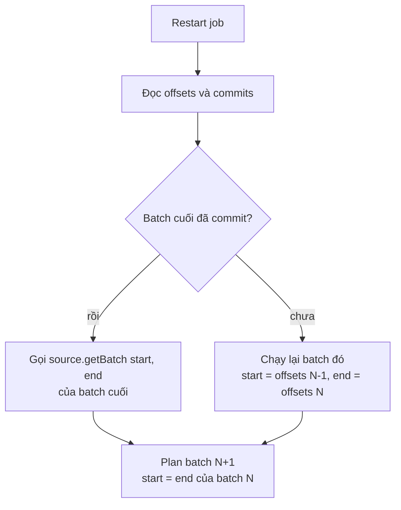
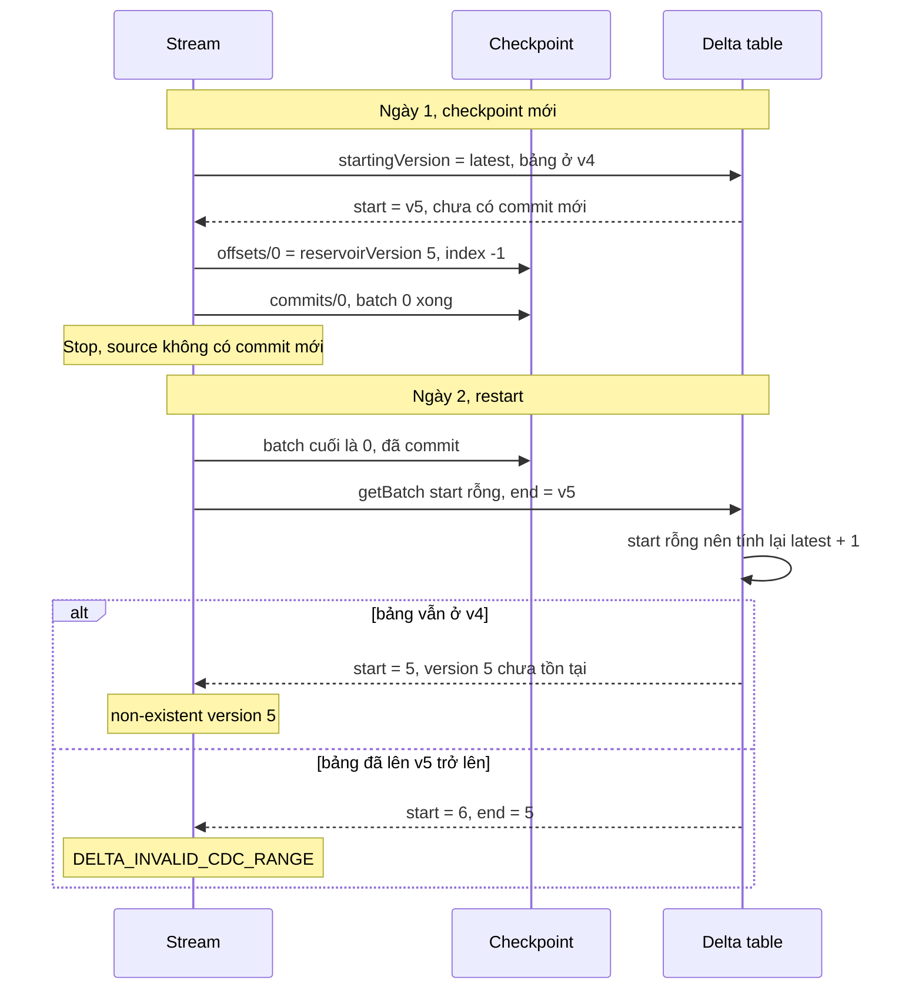
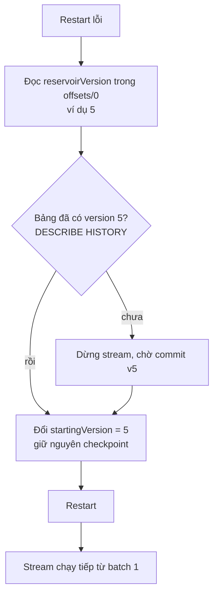

Hai streaming job cùng code, cùng config. Một job restart bình thường, một job chết ngay khi resume checkpoint. Bài này ghi lại cách lần ra nguyên nhân và cách cứu job mà không phải xoá checkpoint.

## 1. Bối cảnh

| Thành phần | Giá trị |
|---|---|
| Runtime | DBR 16.x trở lên |
| Source | Delta table (Unity Catalog external), bật CDF |
| Read mode | Change Data Feed (`readChangeFeed`) |
| Trigger | `processingTime = 15 seconds` |
| `startingVersion` | `latest` |
| Checkpoint | Giữ nguyên qua các lần restart |
| Mục tiêu | Resume đúng tiến độ từ checkpoint cũ |

## 2. Hiện tượng

| | Luồng A | Luồng B |
|---|---|---|
| Source | Liên tục có commit mới | Chỉ upload một file, sau đó im lặng |
| Khi chạy | Xử lý CDC bình thường | Idle |
| Khi restart | Resume từ checkpoint | **Fail**, không resume được |

Ban đầu nghi "source idle" là thủ phạm. Idle chỉ là triệu chứng, nguyên nhân thật ở mục 4.

Hai exception ghi nhận được:

```text
trying to load a non-existent version 5
```

```text
DELTA_INVALID_CDC_RANGE: start 6 -> end 5
```

Offset trong checkpoint (`offsets/0`):

```json
{
  "sourceVersion": 1,
  "reservoirVersion": 5,
  "index": -1,
  "isStartingVersion": false
}
```

| Field | Giá trị | Ý nghĩa |
|---|---|---|
| `sourceVersion` | `1` | Version của format offset |
| `reservoirVersion` | `5` | Version Delta kế tiếp cần đọc |
| `index` | `-1` | `BASE_INDEX`, chưa đọc file nào của version này |
| `isStartingVersion` | `false` | Không phải offset khởi tạo (snapshot ban đầu) |

Hai lỗi chỉ là hai mặt của cùng một nguyên nhân, khác nhau ở thời điểm restart: bảng chưa có v5 thì báo không tìm thấy version, bảng đã vượt v5 thì báo range ngược.

## 3. Restart làm gì với batch cuối?

Structured Streaming lưu tiến độ bằng hai log trong checkpoint:

| Log | Nội dung | Ghi khi nào |
|---|---|---|
| `offsets/N` | **End offset** của batch N | Trước khi xử lý batch |
| `commits/N` | Đánh dấu batch N đã xong | Sau khi sink thành công |

Start offset của batch N không được lưu riêng. Nó chính là end offset của batch N-1.

Khi restart, `MicroBatchExecution.populateStartOffsets` đọc batch cuối trong hai log. Nếu batch cuối đã commit, Spark chưa plan batch tiếp ngay. Nó gọi lại `source.getBatch(start, end)` của batch đó một lần rồi mới plan batch N+1. Comment trong source giải thích lý do: *"certain sources assume on restart the last batch will be executed before getOffset is called again"*. DataFrame trả về bị bỏ đi, mục đích chỉ là đưa source về đúng trạng thái.



Với batch N ≥ 1, `start` lấy từ `offsets/N-1` nên luôn đủ dữ liệu. Vấn đề nằm ở **batch 0**.

## 4. Root cause

Batch 0 là batch đầu tiên của checkpoint mới, không có batch -1. **Start của batch 0 không được lưu ở đâu cả**, nên khi recover `start = None`.

Lần chạy đầu thì không sao: Delta thấy start rỗng nên tự tính từ `startingVersion = latest`. Nhưng ở lần restart, bước recover gọi `getBatch(None, offsets/0)` và Delta làm đúng như vậy một lần nữa: **tính lại `latest` tại thời điểm restart**, trong khi `end` đã bị đóng đinh ở v5.

`latest` chỉ có nghĩa ở lần chạy đầu tiên. Restart tính lại với một "bây giờ" khác.

Offset `(5, -1)` còn cho biết lúc batch 0 chạy, bảng đang ở v4 và chưa có commit nào mới để đọc. Batch 0 thực chất là một batch rỗng, chỉ có nhiệm vụ ghi lại điểm bắt đầu. Source im lặng thì stream không sinh được batch 1, checkpoint kẹt ở batch 0.



| Trạng thái bảng lúc restart | `latest + 1` | Kết quả |
|---|---|---|
| Vẫn ở v4 | 5 | Version 5 chưa tồn tại: `non-existent version 5` |
| Đã lên v5 trở lên | 6 trở lên | `start > end (5)`: `DELTA_INVALID_CDC_RANGE` |

### Đối chiếu với source

Truy vết trên source Spark và Delta (master):

| Bước | Code | Điều xảy ra |
|---|---|---|
| 1 | `MicroBatchExecution.populateStartOffsets` | Batch cuối đã commit nên gọi `source.getBatch(start, end)`. Batch 0 không có `offsets/-1` nên `start = None` |
| 2 | `DeltaSource.getBatch`, `extractStartingState` | `start` rỗng thì gọi `resolveFirstBatchStartVersion(endOffset, getStartingVersion)` |
| 3 | `getStartingVersionFromOptions` | `latest` được resolve **lúc gọi** thành `update().version + 1` |
| 4 | `CDCReader.changesToDF(start, end)` | `end = endOffset.reservoirVersion = 5` lấy từ `offsets/0` |
| 5a | `changesToDF`, kiểm tra `end < start` | Ném `DELTA_INVALID_CDC_RANGE` |
| 5b | `changesToDF`, `getSnapshotAt(start)` | Version chưa có thì ném lỗi `non-existent version` |

Lỗi nằm ở bước 3. `resolveFirstBatchStartVersion` có nhánh `startingVersion = None` dùng `endOffset.reservoirVersion - 1`, nhánh này recover đúng. Nhưng khi option `startingVersion` được set, giá trị option luôn thắng offset đã lưu.

Docs ghi `startingVersion` bị bỏ qua khi checkpoint đã có progress. Case này là ngoại lệ vì recover batch 0 không có start offset.

Lưu ý: code trên là bản OSS. DBR dùng bản Delta của Databricks, nên cần xác nhận hiện tượng bằng các lệnh ở mục 6.

### Vì sao luồng A không chết?

Batch cuối của luồng A đã là batch N lớn, start lấy từ `offsets/N-1` nên không bao giờ phải tính lại `latest`.

Idle không phải nguyên nhân. Idle chỉ là điều kiện khiến checkpoint dừng đúng ở batch 0. Luồng bận mà vừa tạo checkpoint xong đã bị restart cũng dính y hệt.

## 5. Kịch bản tái hiện

1. Bảng nguồn đang ở v4. Tạo checkpoint mới, `startingVersion = latest`.
2. Batch 0 chạy, không có commit mới, ghi `offsets/0 = (5, -1)` rồi commit.
3. Dừng stream, source không có commit mới.
4. Restart khi bảng vẫn ở v4: `non-existent version 5`.
5. Hoặc restart sau khi bảng đã có v5, v6, v7: `DELTA_INVALID_CDC_RANGE: start 6 -> end 5`.

## 6. Xác minh trên Databricks

Ba việc cần kiểm tra: checkpoint có kẹt ở batch 0 không, `reservoirVersion` là bao nhiêu, và bảng nguồn đang ở version nào.

**Đọc checkpoint** (notebook, đường dẫn là cloud storage hoặc UC volume):

```python
ckpt = "/Volumes/catalog/schema/vol/checkpoints/my_stream"

display(dbutils.fs.ls(f"{ckpt}/offsets"))   # chỉ có file 0 là dấu hiệu của bug
display(dbutils.fs.ls(f"{ckpt}/commits"))   # chỉ có file 0

print(dbutils.fs.head(f"{ckpt}/offsets/0"))
```

File `offsets/0` có 3 dòng: `v1`, metadata của batch (watermark, timestamp, conf), và offset của source. Dòng thứ ba chứa `reservoirVersion`:

```text
v1
{"batchWatermarkMs":0,"batchTimestampMs":...,"conf":{...}}
{"sourceVersion":1,"reservoirVersion":5,"index":-1,"isStartingVersion":false}
```

**Xem version hiện tại của bảng nguồn:**

```sql
DESCRIBE HISTORY catalog.schema.source_table LIMIT 5;
```

Cột `version` của dòng đầu tiên là version mới nhất. So với `reservoirVersion`:

| So sánh | Ý nghĩa |
|---|---|
| `reservoirVersion` > version mới nhất | Bảng chưa có version mà offset trỏ tới. Phải chờ commit mới |
| `reservoirVersion` ≤ version mới nhất | Version đã tồn tại. Đổi `startingVersion` rồi restart được ngay |

**Kiểm tra CDF và retention của bảng:**

```sql
SHOW TBLPROPERTIES catalog.schema.source_table;
-- delta.enableChangeDataFeed, delta.logRetentionDuration
```

## 7. Cách fix

Ép Delta dùng đúng điểm bắt đầu của batch 0 thay vì tính lại `latest`. Điểm đó chính là `reservoirVersion` trong `offsets/0`.

```python
(spark.readStream
    .format("delta")
    .option("readChangeFeed", "true")
    .option("startingVersion", 5)   # reservoirVersion trong offsets/0
    .table("catalog.schema.source_table"))
```

Khi đó `getBatch(None, offsets/0)` có `start = 5`, `end = 5`, range hợp lệ. Giữ nguyên checkpoint. Option chỉ ảnh hưởng bước recover batch 0. Từ batch 1 trở đi, start lấy từ checkpoint.

Cả hai tình huống đều đổi `startingVersion`. Khác nhau ở chỗ có phải chờ hay không, vì `changesToDF` gọi `getSnapshotAt(5)` nên version 5 phải tồn tại:

| Tình huống | Cách xử lý |
|---|---|
| Source chưa có commit mới (bảng vẫn ở v4) | Dừng stream, **chờ version 5 xuất hiện**, rồi restart với `startingVersion = 5` |
| Source đang commit liên tục (bảng đã từ v5 trở lên) | Restart ngay với `startingVersion = 5` |



Chỉ chờ v5 mà vẫn để `latest` thì không đủ. Bảng ở v4 thì `latest + 1 = 5` chưa tồn tại. Bảng lên v5 thì `latest + 1 = 6 > 5`, vẫn `DELTA_INVALID_CDC_RANGE`. Chờ chỉ có ý nghĩa khi đi kèm `startingVersion = 5`.

Sau khi batch 1 chạy xong, recover sẽ lấy start từ `offsets/0` nên option không còn tác dụng, có thể giữ nguyên.

## 8. Phòng tránh

- **Không để checkpoint dừng ở batch 0** khi dùng `latest`. Job mới nên chạy qua vài batch có data rồi mới dừng.
- **Dùng `startingVersion` cụ thể** khi tạo job mới (version hiện tại + 1 lúc deploy) thay vì `latest`. Mọi lần restart đều resolve ra cùng một giá trị.
- **Alert cho `DELTA_INVALID_CDC_RANGE`** ở các job chạy theo lịch trên source thưa commit.

## Tóm tắt

| Mục | Nội dung |
|---|---|
| Lỗi | `non-existent version 5`, `DELTA_INVALID_CDC_RANGE (6 -> 5)` |
| Điều kiện | Checkpoint chỉ có batch 0 đã commit, `startingVersion = latest` |
| Nguyên nhân | Start của batch 0 không được lưu. Bước recover `getBatch(None, end)` tính lại `latest` theo thời điểm restart |
| Fix | `startingVersion = reservoirVersion` trong `offsets/0`, giữ checkpoint, chờ version đó tồn tại |
| Phòng tránh | Tránh `latest`, dùng version cụ thể |

## Tài liệu tham khảo

- [Spark Structured Streaming: Recovering from Failures with Checkpointing](https://spark.apache.org/docs/latest/streaming/apis-on-dataframes-and-datasets.html#recovering-from-failures-with-checkpointing)
- [Databricks: Structured Streaming checkpoints](https://docs.databricks.com/aws/en/structured-streaming/checkpoints)
- [Databricks: Delta table streaming reads and writes](https://docs.databricks.com/aws/en/structured-streaming/delta-lake)
- [Delta Lake: Specify initial position](https://docs.delta.io/latest/delta-streaming.html#specify-initial-position)
- [Databricks: Use Delta Lake change data feed](https://docs.databricks.com/aws/en/delta/delta-change-data-feed)

## Các case liên quan

- [Databricks KB: Streaming application missing data from a Delta table](https://kb.databricks.com/streaming/streaming-application-missing-data-from-a-delta-table-when-writing-to-a-given-destination)
- [Databricks KB: Resumed streaming job fails after pause](https://kb.databricks.com/streaming/resumed-streaming-job-fails-after-pause-with-streamingqueryexception-error)
- [Community: Delete on streaming table and startingVersion](https://community.databricks.com/t5/data-engineering/delete-on-streaming-table-and-starting-startingversion/m-p/67959)
- [Community: How to use checkpoint with change data feed](https://community.databricks.com/t5/data-engineering/how-to-use-checkpoint-with-change-data-feed/m-p/5323)
