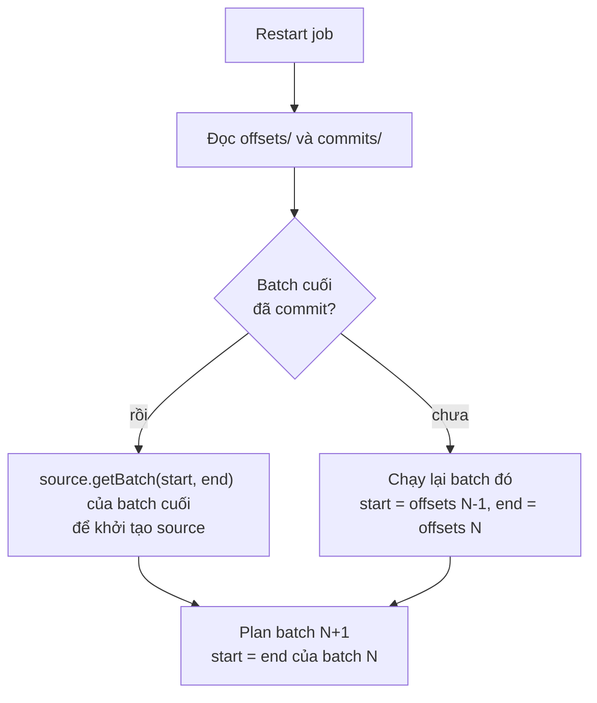
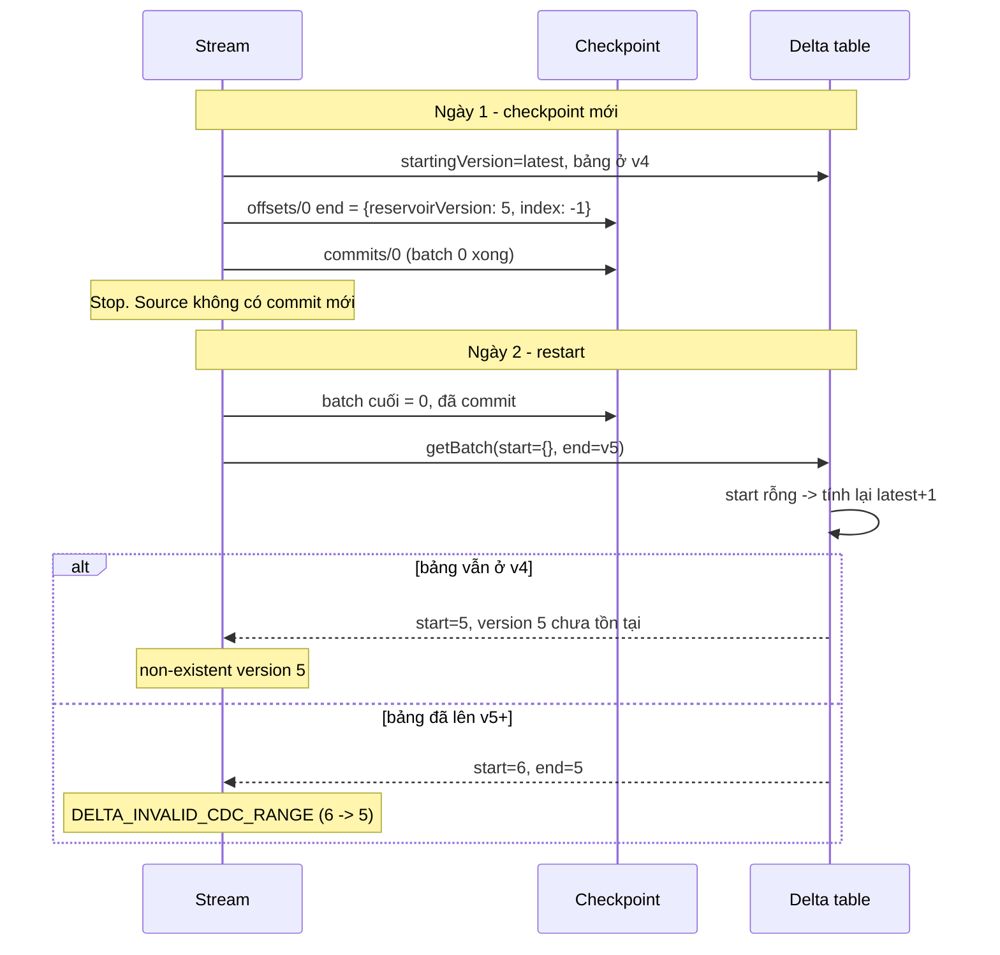
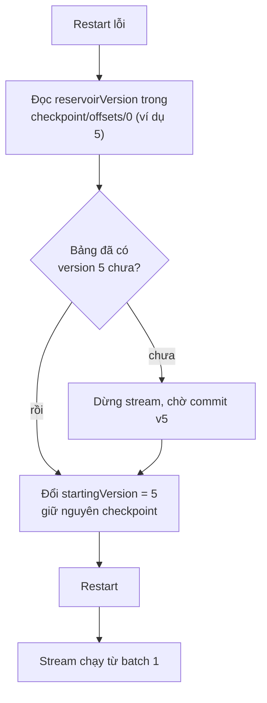

Hai streaming job cùng code, cùng config. Một job restart bình thường, một job chết ngay khi resume checkpoint. Bài này ghi lại quá trình lần ra nguyên nhân và cách fix.

## 1. Bối cảnh

| Thành phần | Giá trị |
|---|---|
| Runtime | DBR 16.x+ |
| Source | Delta table (Unity Catalog external), bật CDF |
| Read mode | Change Data Feed (`readChangeFeed`) |
| Trigger | `processingTime = 15 seconds` |
| `startingVersion` | `latest` |
| Checkpoint | Giữ nguyên qua các lần restart |
| Mục tiêu | Resume đúng tiến độ từ checkpoint cũ |

## 2. Hiện tượng

- **Luồng A**: source liên tục có commit mới, restart resume bình thường.
- **Luồng B**: source chỉ có một lần upload file (Auto Loader), sau đó im lìm. Restart là chết.

Lúc đầu nghi "source idle" là thủ phạm. Nhưng idle chỉ là triệu chứng. Chốt ở phần 4.

Hai exception ghi nhận được:

```text
trying to load a non-existent version 5
```

```text
DELTA_INVALID_CDC_RANGE: start 6 -> end 5
```

Offset trong checkpoint (`offsets/0`):

```json
{
  "sourceVersion": 1,
  "reservoirVersion": 5,
  "index": -1,
  "isStartingVersion": false
}
```

| Field | Ý nghĩa |
|---|---|
| `sourceVersion` | Version của format offset |
| `reservoirVersion` | Delta version mà offset trỏ tới (ở đây là 5) |
| `index` | `-1` = chưa đọc file nào của version này, tức là sẵn sàng đọc từ đầu version 5 |
| `isStartingVersion` | `false` = không phải offset khởi tạo (snapshot ban đầu) |

Hai lỗi lệch nhau ở chỗ: lỗi đầu đòi version 5 chưa tồn tại, lỗi sau đòi range 6 → 5 bị ngược. Cùng một nguyên nhân, khác thời điểm chạy.

## 3. Cơ chế cần hiểu: restart làm gì với batch cuối?

Structured Streaming lưu tiến độ bằng hai log trong checkpoint:

- `offsets/N`: **end offset** của batch N, ghi *trước* khi xử lý.
- `commits/N`: đánh dấu batch N đã xử lý xong, ghi *sau* khi sink thành công.

Start offset của batch N không được lưu riêng. Nó chính là end offset của batch N-1.

Khi restart, `MicroBatchExecution.populateStartOffsets` đọc batch cuối trong `offsets` và `commits`. Nếu batch cuối đã commit, Spark không plan batch kế tiếp ngay. Nó gọi lại `source.getBatch(start, end)` của batch đó một lần, rồi mới plan batch N+1. Comment trong source Spark giải thích lý do: *"certain sources assume on restart the last batch will be executed before getOffset is called again"*. Kết quả DataFrame bị bỏ đi, mục đích chỉ là đưa source về đúng trạng thái.



Với batch N ≥ 1, `start` lấy từ `offsets/N-1`, nên có đủ dữ liệu. Vấn đề nằm ở **batch 0**.

## 4. Root cause

Batch 0 là batch đầu tiên của checkpoint mới. Không có batch -1, nên **start của batch 0 không được lưu ở đâu cả**. Log ghi nhận `start offsets = {}`.

Lúc chạy lần đầu thì không sao, Delta thấy start rỗng và tự tính từ `startingVersion = latest`. Nhưng ở lần restart, bước recover gọi `getBatch({}, offsets/0)` và Delta lại làm đúng như vậy: **tính lại `latest` tại thời điểm hiện tại**, trong khi `end` bị đóng đinh ở version 5.

Nói cách khác, `latest` vốn chỉ có nghĩa ở lần chạy đầu tiên, nhưng restart lại tính lần nữa với "bây giờ" khác.



Giải thích luôn hai lỗi:

- Bảng ở v4: `latest + 1 = 5`, nhưng v5 chưa có → `non-existent version 5`.
- Bảng đã có thêm commit (v5, v6, ...): `latest + 1 ≥ 6` trong khi `end` vẫn là 5 → range 6 → 5 → `DELTA_INVALID_CDC_RANGE`.

### Đối chiếu với source

Mình đọc lại source Spark và Delta (master) để kiểm tra từng bước:

| Bước | Code | Điều xảy ra |
|---|---|---|
| 1 | `MicroBatchExecution.populateStartOffsets` | `latestBatchId == latestCommittedBatchId` nên gọi `source.getBatch(start, end)`. `start = startOffsets.get(source)`, mà batch 0 không có `offsets/-1` nên `start = None` |
| 2 | `DeltaSource.getBatch` → `extractStartingState` | `start` rỗng thì gọi `resolveFirstBatchStartVersion(endOffset, getStartingVersion)` |
| 3 | `getStartingVersionFromOptions` | `startingVersion = latest` được resolve **lúc gọi** thành `streamingBackend.update().version + 1` |
| 4 | `getCDCFileChangesAndCreateDataFrame` → `CDCReader.changesToDF(start, end = endOffset.reservoirVersion)` | `end` là 5 lấy từ `offsets/0` |
| 5a | `changesToDF`: `end < start` | ném `DELTA_INVALID_CDC_RANGE` (start 6, end 5) |
| 5b | `changesToDF`: `getSnapshotAt(start)` | version 5 chưa có thì ném lỗi `non-existent version` |

Chốt lại: lỗi nằm ở bước 3. Hàm `resolveFirstBatchStartVersion` có nhánh `startingVersion = None` dùng `endOffset.reservoirVersion - 1`, tức là nhánh này recover đúng. Nhưng khi option `startingVersion` được set, nó luôn ưu tiên giá trị option và bỏ qua offset đã lưu.

Hai điểm mình sửa lại so với bản trước:

- `index = -1` là `BASE_INDEX` của Delta: "chưa đọc file nào của version này". `reservoirVersion = 5` nghĩa là offset trỏ tới *version kế tiếp cần đọc*, không phải version đã đọc xong.
- Stream bị lỗi là stream đọc **Delta CDF**, không phải Auto Loader. Auto Loader (`cloudFiles`) chỉ là thứ ghi vào bảng nguồn và làm version tăng. Auto Loader có checkpoint riêng, không liên quan tới lỗi này.

### Vì sao luồng A không chết?

Vì trong Luồng A, đến lúc restart batch cuối đã là batch N rất lớn. Start của nó lấy từ `offsets/N-1` có đầy đủ, không bao giờ phải tính lại `latest`.

Vậy "idle" không phải nguyên nhân, mà là **điều kiện dẫn tới việc checkpoint chỉ có đúng batch 0**: source không có commit mới nên stream không sinh batch thứ 2 trước khi bị dừng. Một luồng bận mà vừa tạo checkpoint xong đã bị restart cũng có thể dính y hệt.

## 5. Kịch bản tái hiện

1. Tạo checkpoint mới, `startingVersion = latest`, bảng đang ở v3.
2. Auto Loader upload một file, bảng lên v4. Batch 0 chạy và commit, offset ghi `reservoirVersion: 5`.
3. Dừng stream. Không có commit mới.
4. Ngày hôm sau chạy lại → `non-existent version 5`.
5. Hoặc: trong lúc đó có thêm file mới (v5, v6, v7) rồi chạy lại → `DELTA_INVALID_CDC_RANGE: start 6 -> end 5`.

## 6. Cách fix

Mấu chốt: ép Delta dùng đúng điểm bắt đầu của batch 0 thay vì tính lại `latest`. Điểm đó chính là `reservoirVersion` trong `offsets/0`.

**Fix chung cho cả hai tình huống: đổi `startingVersion` từ `latest` thành `reservoirVersion`.**

```python
(spark.readStream
    .format("delta")
    .option("readChangeFeed", "true")
    .option("startingVersion", 5)   # = reservoirVersion trong offsets/0
    .table("catalog.schema.source_table"))
```

Lúc đó `getBatch(None, offsets/0)` có `start = 5`, `end = 5`: range hợp lệ, không tính lại gì cả. Giữ nguyên checkpoint. Option này chỉ ảnh hưởng đúng bước recover batch 0. Từ batch 1 trở đi, start lấy từ checkpoint.

Điều kiện còn lại phụ thuộc bảng nguồn đang ở đâu, vì `changesToDF` gọi `getSnapshotAt(5)` và version 5 phải tồn tại:

| Tình huống | Cách xử lý |
|---|---|
| **Source chưa có commit mới** (bảng vẫn ở v4) | Dừng stream, **chờ version 5 xuất hiện**, rồi restart với `startingVersion = 5` |
| **Source đang commit liên tục** (bảng đã ≥ v5) | Restart ngay với `startingVersion = 5` |



Một chỗ cần cẩn thận: **chỉ chờ v5 mà vẫn để `latest` thì không đủ.** Theo code, khi bảng ở v4 thì `latest + 1 = 5` và v5 chưa tồn tại. Khi bảng lên v5 thì `latest + 1 = 6`, `6 > 5` nên vẫn dính `DELTA_INVALID_CDC_RANGE`. Chờ v5 chỉ có ý nghĩa khi đi kèm `startingVersion = 5`.

Kiểm tra offset trước khi sửa:

```bash
cat <checkpoint>/offsets/0
```

## 7. Phòng tránh

- **Đừng để checkpoint dừng ở batch 0** nếu dùng `latest`. Với job mới, đợi có ít nhất vài batch rồi hãy stop.
- **Dùng `startingVersion` cụ thể** khi tạo job mới (ví dụ version hiện tại + 1 lúc deploy) thay vì `latest`. Kết quả resolve ra luôn giống nhau ở mọi lần restart.
- Job nào chỉ chạy theo lịch với source thưa commit nên có alert cho lỗi `DELTA_INVALID_CDC_RANGE` để bắt sớm.

## Tóm tắt

| | |
|---|---|
| Lỗi | `non-existent version 5`, `DELTA_INVALID_CDC_RANGE (6 -> 5)` |
| Điều kiện | Checkpoint chỉ có batch 0 đã commit, `startingVersion = latest` |
| Nguyên nhân | Start của batch 0 không được lưu. Bước recover `getBatch({}, end)` tính lại `latest` theo thời điểm restart |
| Fix | Đặt `startingVersion = reservoirVersion` trong `offsets/0`, giữ nguyên checkpoint. Nếu bảng chưa có version đó thì chờ nó xuất hiện trước khi restart |
| Phòng tránh | Tránh `latest`, dùng version cụ thể |

## Tài liệu tham khảo

- [Spark Structured Streaming: Recovering from Failures with Checkpointing](https://spark.apache.org/docs/latest/streaming/apis-on-dataframes-and-datasets.html#recovering-from-failures-with-checkpointing)
- [Databricks: Structured Streaming checkpoints](https://docs.databricks.com/aws/en/structured-streaming/checkpoints)
- [Databricks: Delta table streaming reads and writes](https://docs.databricks.com/aws/en/structured-streaming/delta-lake) (`startingVersion`, `latest`)
- [Delta Lake: Table streaming reads and writes, specify initial position](https://docs.delta.io/latest/delta-streaming.html#specify-initial-position)
- [Databricks: Use Delta Lake change data feed](https://docs.databricks.com/aws/en/delta/delta-change-data-feed)

Các case liên quan (không trùng hẳn, nhưng cùng họ lỗi):

- [Databricks KB: Streaming application missing data from a Delta table](https://kb.databricks.com/streaming/streaming-application-missing-data-from-a-delta-table-when-writing-to-a-given-destination): restart bằng `startingVersion = latest` có thể mất dữ liệu, nên đặt `X+1` lấy từ offsets của checkpoint cũ.
- [Databricks KB: Resumed streaming job fails after pause](https://kb.databricks.com/streaming/resumed-streaming-job-fails-after-pause-with-streamingqueryexception-error): stream dừng quá 30 ngày thì mất log do `logRetentionDuration`, lỗi cũng là không tìm thấy version.
- [Community: Delete on streaming table and startingVersion](https://community.databricks.com/t5/data-engineering/delete-on-streaming-table-and-starting-startingversion/m-p/67959): khi checkpoint đã tồn tại thì `startingVersion` nên bị bỏ qua.
- [Community: How to use checkpoint with change data feed](https://community.databricks.com/t5/data-engineering/how-to-use-checkpoint-with-change-data-feed/m-p/5323): job restart lại bắt đầu ở cùng version thay vì tiếp tục từ checkpoint (thread chưa có câu trả lời xác nhận).

Docs ghi rằng `startingVersion` chỉ áp dụng cho query mới và bị bỏ qua khi checkpoint đã có progress. Case trong bài này là ngoại lệ: bước recover batch 0 không có start offset, nên option vẫn được dùng. Docs cũng nói version chỉ định mà không tồn tại thì stream fail, khớp với yêu cầu phải chờ v5 xuất hiện ở mục 6.
